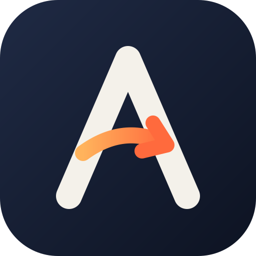

<h1 align="center">Ashync</h1>

  Tailored resumes and cover letters, written only from facts you've given it, plus a job finder for roles in India. 
  A desktop app for Windows and Linux.

  <a href="https://github.com/Ashath-IS/ashync/releases/latest"><b>⬇ Download the latest version</b></a>

---

## What it does

- **Paste a job description, get a one-page resume and cover letter as PDFs.** Every technology and number in
  them is checked against your profile; anything it can't back up is fixed or removed. A Trace view shows each
  line next to the fact it came from.
- **Your profile, from your resume.** Upload your current resume PDF and Ashync fills in your profile; edit
  skills, roles and projects from there.
- **Your own resume style.** Import any resume PDF as a template, and Ashync prints your content in that layout.
- **Jobs that fit you.** Connect the Gmail account that receives job alerts (LinkedIn, Naukri, Indeed, Foundit,
  Instahyre) and Ashync lists the roles you can take from India, scored against your profile. Click a skill you're
  missing to add it to your profile.

## Download

Open the [latest release](https://github.com/Ashath-IS/ashync/releases/latest) and pick the file for your computer:

| Your computer | Download | Then |
|---|---|---|
| **Windows 10 / 11** | `Ashync-<version>-x64-setup.exe` | Run it. It installs for your user only (no admin needed) and adds Start menu and desktop shortcuts. |
| Windows, no install | `Ashync-<version>-x64-portable.exe` | Run it directly. It doesn't update itself: download new versions here. |
| **Ubuntu / Debian** | `Ashync-<version>-amd64.deb` | `sudo apt install ./Ashync-*.deb`, then open Ashync from your apps. |
| Other Linux | `Ashync-<version>-x86_64.AppImage` | `chmod +x Ashync-*.AppImage` and run it. On Ubuntu 24.04+ install `libfuse2t64` first. |

**"Windows protected your PC"?** Ashync isn't code-signed yet, so Windows SmartScreen warns about new apps.
Click **More info → Run anyway**.

## Updates

From version 0.1.3, Ashync updates itself. When a new version is out, it downloads in the background and
Ashync shows **Restart to update**; **Help → Check for Updates** checks now. Your data is backed up before
each update (to `backups/` in the data folder). On an older version? Install the latest one over it once.

## Before you start

Ashync writes with an AI model that you choose. Open **Models** in the app and add one:

- **A hosted model**: an API key from [OpenRouter](https://openrouter.ai), [Groq](https://groq.com) or OpenAI. Paste the key, pick a model from the list, press **Test**, then **Use for new**.
- **A model on your own computer**: [Ollama](https://ollama.com), [LM Studio](https://lmstudio.ai) or llama.cpp. Use its address, for example `http://127.0.0.1:11434/v1` for Ollama.

PDFs are printed with a browser that's already on your computer: Microsoft Edge (built into Windows), Chrome, Chromium or Brave.

## Your data

Everything stays on your computer: your profile, applications, saved jobs and API keys (stored encrypted).

| | Folder |
|---|---|
| Windows | `%APPDATA%\Ashync` |
| Linux | `~/.config/Ashync` |

**Help → Open Data Folder** opens it. To back up, copy the whole folder: `.app_secret` is what decrypts your saved keys.
Your resume text goes only to the AI model you choose; Gmail is read-only and only job-alert emails are read.

## Problems

**Help → Open Logs Folder** in the app shows `server.log`. Please [open an issue](https://github.com/Ashath-IS/ashync/issues) with it.
